# Finora

Finora is a personal expense tracker for Android and iOS, built with Flutter.
Record what you spend, set a monthly budget and a limit for each category, and
see where your money goes. On supported mobile platforms, your financial data
is stored locally in SQLite, with alerts as you approach or exceed a budget.

[Features](#features) · [Screenshots](#screenshots) ·
[Getting started](#getting-started) · [Architecture](#how-it-works) ·
[Tests](#tests)

<p align="center">
  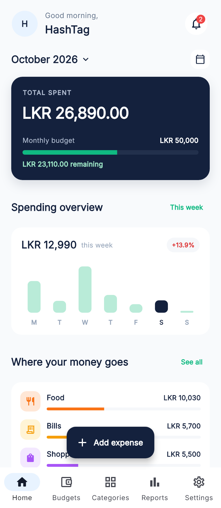
  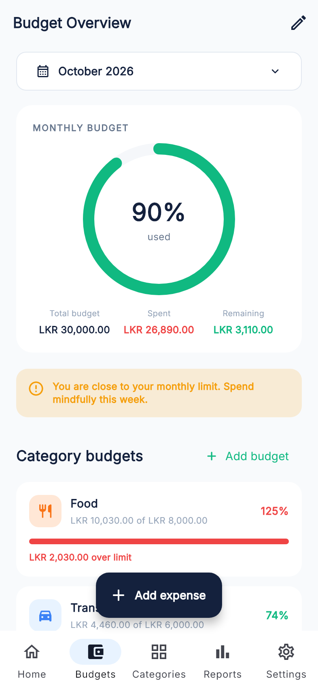
  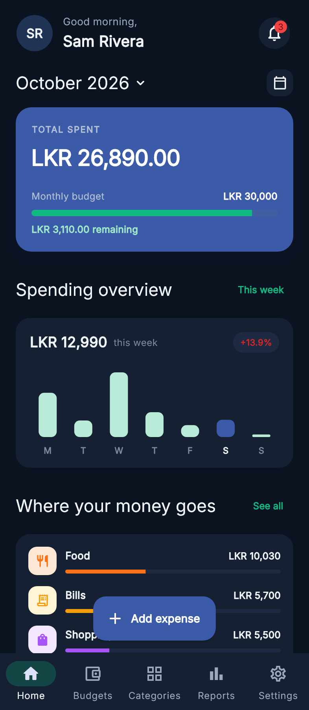
</p>

## Features

- **Expense recording**: amount, title, category, date and an optional note.
- **Edit and delete**: every expense row has a "⋮" menu with Edit and Delete.
  Deleting asks first and offers Undo.
- **Categories**: choose from ready-made categories, reveal more under
  "Other", or create your own with a name and icon, during setup, on the
  Categories tab, or straight from the Add Expense form.
- **Budget tracking**: a monthly budget plus a spending limit per category,
  with progress bars and over-budget warnings.
- **Expense history**: grouped by date, with search, category, date and amount
  filters and a month picker.
- **Summaries**: Home shows this month's total, a weekly chart and your top
  categories. Monthly Reports adds a category chart, a weekly breakdown and a
  month-by-month comparison.
- **Notifications**: the bell on Home lists current budget alerts. The same
  alerts are also sent to the phone's notification tray, once each.
- **First-run setup**: a welcome screen, then your name, budget, savings goal,
  favourite categories and their limits. It is shown only once.
- **Profile**: edit your name and email, add a photo from the camera or gallery,
  and set a savings goal.
- **Light and dark themes** with a choice of accent colour.
- **Works offline**: all data is saved in a local SQLite database.

## Screenshots

### First launch

| Welcome | Setup |
|:---:|:---:|
| 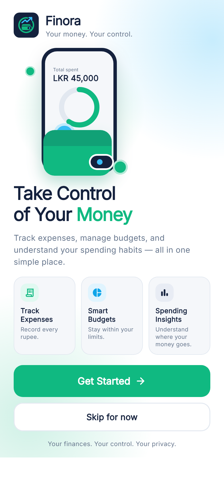 | 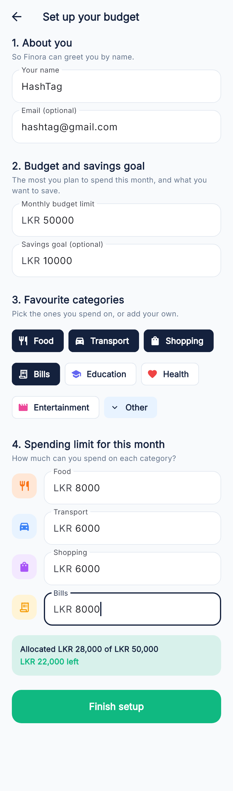 |

### Everyday use

| Home | Add expense | Expense details |
|:---:|:---:|:---:|
|  | 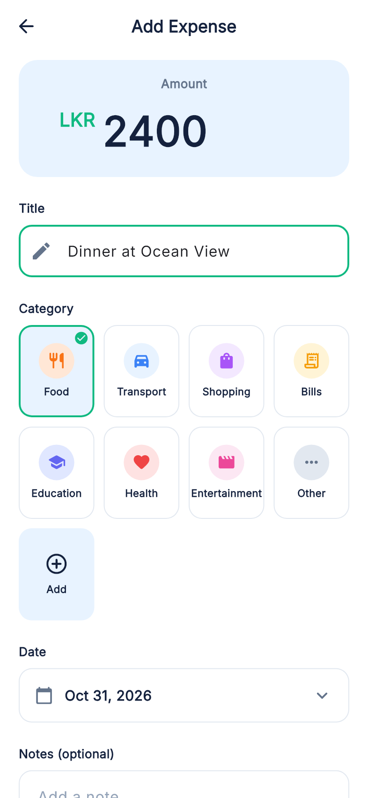 | 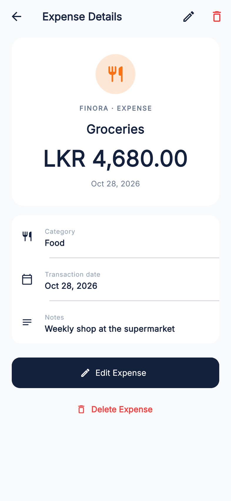 |

| History with Edit / Delete | Budgets | Categories |
|:---:|:---:|:---:|
| 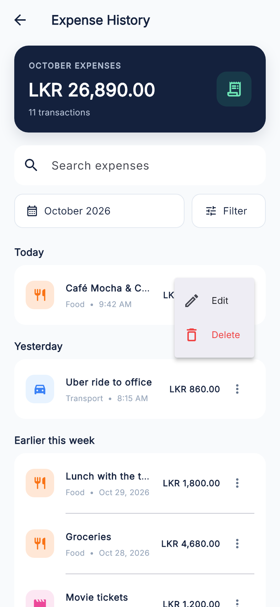 |  | 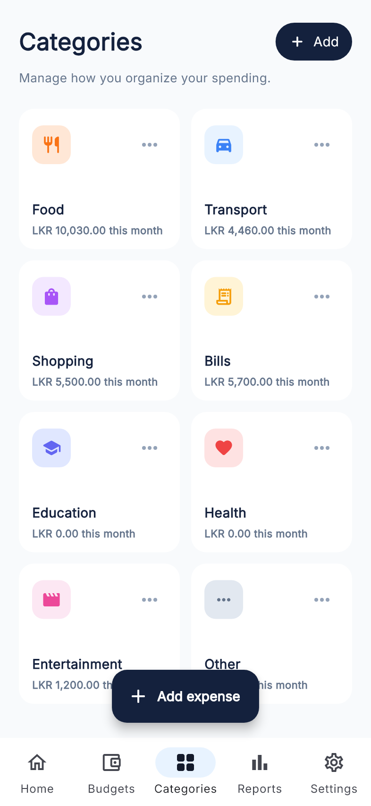 |

| Monthly reports | Notifications | Profile |
|:---:|:---:|:---:|
| 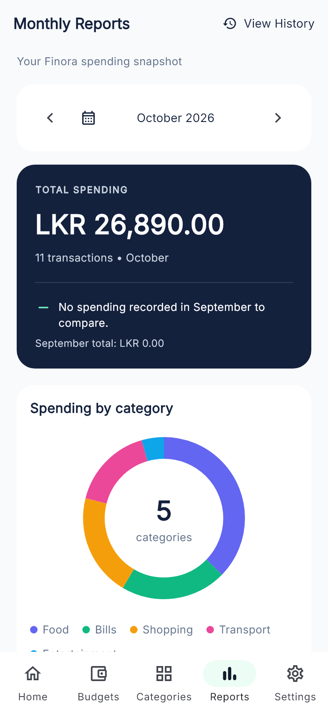 | 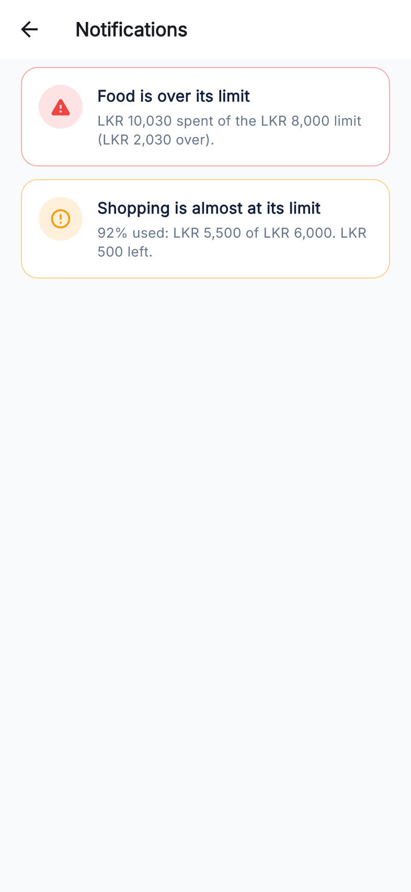 | 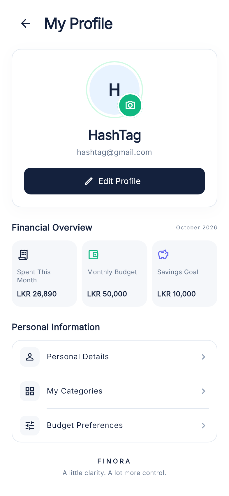 |

| Settings |
|:---:|
| 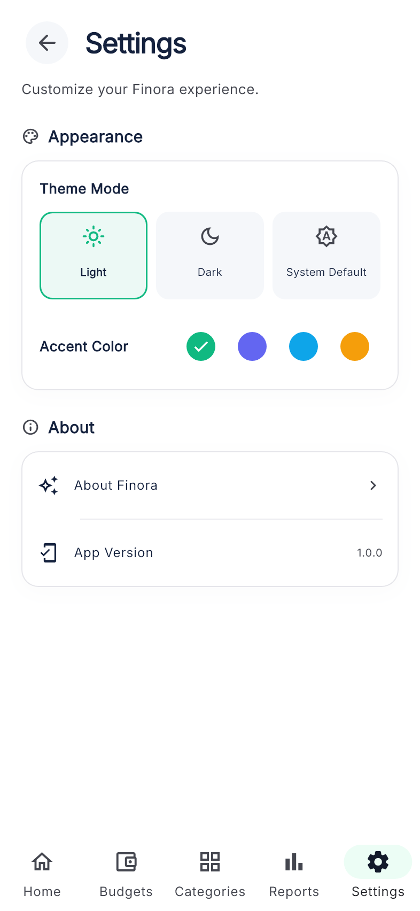 |

### Dark mode

| Home | Budgets | Reports |
|:---:|:---:|:---:|
|  | 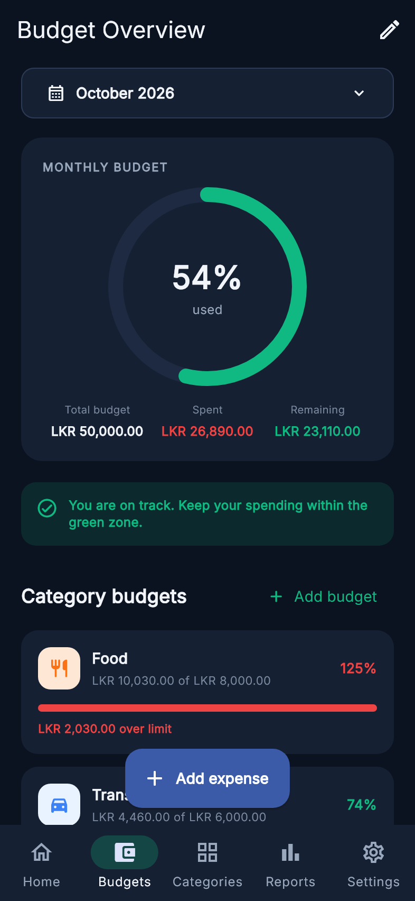 | 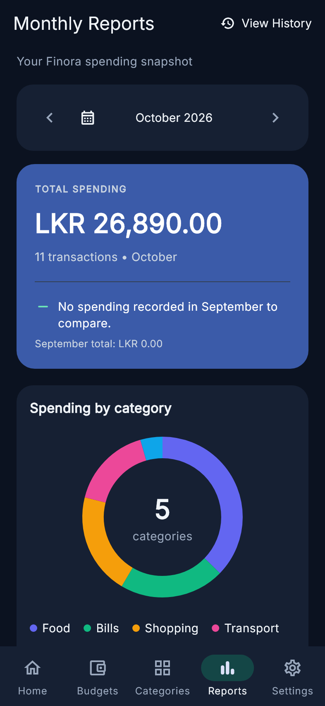 |

> The screenshots use sample data and are rendered from the real screens.

## Built with

| Area | Choice |
|---|---|
| Framework | Flutter / Dart with Material 3 |
| Local database | [`sqflite`](https://pub.dev/packages/sqflite) (SQLite) |
| Onboarding preference | [`shared_preferences`](https://pub.dev/packages/shared_preferences) |
| Notifications | [`flutter_local_notifications`](https://pub.dev/packages/flutter_local_notifications) |
| Profile photo | [`image_picker`](https://pub.dev/packages/image_picker) |
| State management | One `ChangeNotifier` store shared through an `InheritedNotifier` |
| Font | Inter (bundled, SIL Open Font License) |

## How it works

- **One source of truth.** `FinoraStore` holds the profile, budget, categories,
  limits and expenses. Screens read it through `FinoraScope`, so a change made
  anywhere shows up everywhere straight away.
- **Asynchronous persistence.** Changes update shared state immediately,
  then database writes run in sequence. Stored data is loaded before the
  first screen appears. Failed writes are logged; the app does not currently
  display a save-error message.
- **Alerts are derived, not stored.** `buildNotifications` works out the
  current budget alerts from the real spending. The store compares them with
  the ones already announced this month, so each alert reaches the notification
  tray only once, and can fire again if it clears and returns.
- **Theme-aware colours.** Screens use the colours in `app_colors.dart`
  (`context.ink`, `context.surface`, and so on), which switch between light and
  dark.

### What is saved

| Table | Contents |
|---|---|
| `user_profile` | Name, email, photo, monthly budget, savings goal |
| `categories` | Name, icon, colours, order and monthly limit |
| `expenses` | Title, category, amount, date, icon, colours and notes |
| `settings` | Theme, accent colour and the alerts already announced |

SharedPreferences keeps one flag, whether the welcome flow has been completed,
so it is shown only once. Clearing the app's data brings it back.

## Project structure

```text
lib/
  main.dart                      App start-up, theme, navigation
  data/
    finora_database.dart         SQLite storage
    notification_service.dart    System notifications (Android / iOS)
  screens/
    finora_store.dart            Shared app state and saving
    expense_model.dart           The expense data class
    budget_alerts.dart           Budget and category-limit alert rules
    app_colors.dart              Light / dark colours
    welcome_screen.dart         Welcome screen
    setup_screen.dart           First-run setup
    dashboard_screen.dart        Home
    add_expense_screen.dart      Expense form
    expense_details_screen.dart  Expense details
    expense_history_screen.dart Search and transaction history
    expense_actions.dart        Edit, delete and undo actions
    budget_overview_screen.dart Budgets and category limits
    categories_screen.dart      Category management
    monthly_reports_screen.dart Monthly charts and summaries
    notifications_screen.dart   In-app budget alerts
    profile_screen.dart         Profile management
    settings_screen.dart        Settings interface
    settings_preferences.dart   Appearance preferences
assets/fonts/                   Bundled Inter font and licence
test/                            Unit, widget and golden-image tests
docs/screenshots/                Images used in this README
```

## Getting started

Prerequisites:

- [Flutter SDK](https://docs.flutter.dev/get-started/install) **3.38.1 or newer**
  with **Dart 3.10.4 or newer, below 4.0.0**, as required by the current
  dependency constraints.
- An Android device or emulator with the Android toolchain configured.
  For iOS, use macOS with Xcode and an iOS device or simulator.

From the project root:

```bash
flutter doctor
flutter pub get
flutter run
```

Build an Android APK:

```bash
flutter build apk
```

The APK is generated at `build/app/outputs/flutter-apk/app-release.apk`.
The current Android configuration uses debug signing for release builds.
Configure your application ID and release signing before distributing the app.

### Platform notes

- **SQLite storage and system notifications are initialized only on Android
  and iOS.** Desktop and web use an in-memory financial-data store, so expenses,
  budgets and profile changes are not retained between launches. The onboarding
  flag is stored separately through SharedPreferences.
- On Android 13 and newer, Finora asks for notification permission once, when
  setup finishes. If you decline, alerts still appear inside the app.
- Alerts are sent when something changes inside the app (adding an expense,
  changing a budget or limit). Finora does not schedule reminders while closed.
- The iOS side is configured but has not been built or tested.

## Tests

```bash
flutter analyze
flutter test
```

The tests cover:

- the first-run setup flow and its validation;
- saving to SQLite and loading it back after a restart;
- adding, editing, deleting and undoing expenses;
- the budget alert rules, and that each notification is sent only once;
- the Add / Edit / Delete flows and the category tools;
- reports, dashboard totals and contrast of the light and dark colours.

A few tests compare screens against golden images in `test/goldens`. If you
change how a screen looks on purpose, update them with
`flutter test --update-goldens`.

## Project scope

The core expense-tracking requirements map to these implementations:

| Requirement | Implementation |
|---|---|
| Design expense management screens | Home, Add, Edit, Details, History, Budgets, Categories, Reports |
| Add expense categories | Setup, Categories tab, Add Expense form |
| Store expense records locally | SQLite database (`lib/data/finora_database.dart`) |
| Display expense summaries | Home and Monthly Reports |
| Edit and delete functionality | "⋮" menu on every expense, plus the details screen |
